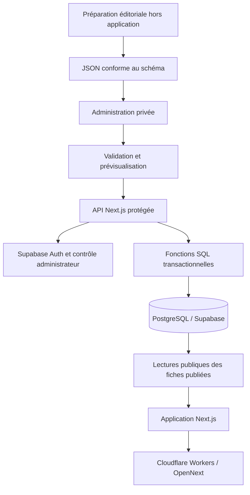

# Architecture technique — Namesia

- **Statut :** architecture de l'application en production
- **Version :** 4.09
- **Mis à jour le :** 2026-11-27 11:05:11 (Europe/Paris)

Ce document décrit les frontières techniques, les flux de données et les responsabilités des couches applicatives. Il ne tient pas lieu de catalogue fonctionnel : les comportements visibles sont décrits dans [Fonctionnalités actuelles](fonctionnalites.md). La vision et le périmètre produit relèvent de [Vision produit](vision-produit.md).

## 1. Vue d'ensemble

Namesia est une application Next.js rendue côté serveur. Supabase fournit l'authentification administrative et PostgreSQL ; Cloudflare Workers héberge l'application via OpenNext.

Aucun modèle IA n'est appelé pendant l'affichage du site. La génération des fiches a lieu en amont ; l'application contrôle le contrat reçu, importe un brouillon et laisse la publication à une action administrative distincte.

## 2. Couches et responsabilités

### Application web

- Next.js App Router, React et TypeScript.
- Rendu serveur pour les pages publiques et les lectures de données.
- Routes serveur pour les opérations d'administration et les accès contrôlés aux données.
- Les clients Supabase utilisent le type `Database` généré depuis le schéma actif.
- La configuration Supabase est centralisée dans `lib/supabase/config.ts` ; les valeurs requises sont validées à la frontière et aucune clé privilégiée n'est exposée au navigateur.

### Administration

- Authentification par lien e-mail OTP via Supabase Auth.
- L'autorisation repose sur la présence de l'identifiant Auth dans `private.admin_users`, vérifiée côté serveur à chaque opération protégée.
- L'import JSON passe par le parseur partagé et une fonction SQL transactionnelle.
- L'import crée une version brouillon ; la publication est une opération séparée, explicite et transactionnelle.

### Données

- PostgreSQL porte le modèle relationnel.
- Le JSON est uniquement le contrat d'échange ; il est validé puis décomposé en colonnes et relations.
- Les versions éditoriales sont conservées séparément de l'identité stable du prénom.
- RLS et les privilèges SQL limitent les lectures publiques aux contenus publiés et les écritures aux administrateurs autorisés.
- Les fonctions SQL restent en `SECURITY INVOKER` et vérifient les autorisations nécessaires.

Le schéma, les tables, les colonnes, les relations, les fonctions et le contrat d'import sont décrits exclusivement dans [Modèle de données](modele-donnees.md) et [le schéma JSON](../schemas/fiche-prenom.schema.json).

## 3. Frontière de sécurité

- Les routes d'administration vérifient le jeton Supabase et l'autorisation administrateur côté serveur.
- Le masquage d'une page ou d'un bouton n'est jamais un contrôle d'accès.
- Aucune clé `service_role`, clé secrète ou autre secret privilégié ne doit atteindre le navigateur.
- Les visiteurs anonymes ne peuvent lire que les fiches publiées.
- Les tables privées ne sont pas exposées par la Data API.
- Les erreurs d'accès ou de données incohérentes ne sont pas transformées en résultats vides qui laisseraient croire à une absence de contenu.

Les procédures de contrôle, de sauvegarde, d'incident et de déploiement sont dans [Opérations](operations.md). Les conventions d'implémentation et de validation sont dans [Standards techniques](standards-techniques.md).

## 4. Interface

Les composants de présentation Material 3 sont centralisés dans `components/material3/` ; les compositions propres aux parcours sont dans `components/features/`. Les composants Material 3 locaux sont des ports React/HTML des contrats AndroidX, pas des composants Compose exécutés dans le navigateur.

Le thème, les tokens, les règles de composition et les limites de fidélité sont définis dans [Système de design](design.md), [Bibliothèque de composants](composants.md) et [Vérification Material 3](material-3-verification.md). Ce document d'architecture ne recopie ni leur catalogue ni leurs dimensions détaillées.

## 5. Hébergement et livraison

- Production : Cloudflare Workers avec OpenNext.
- Données et authentification : Supabase.
- CI, builds, tests, Previews et déploiement : GitHub Actions.
- Les PR internes humaines éligibles disposent d'une Workers Preview isolée ; les forks et PR Dependabot n'obtiennent pas de Preview.
- Seule la branche `main` déclenche le déploiement de production.
- Le retour arrière et les dépendances fournisseur sont traités dans [Portabilité et réversibilité](portabilite-et-reversibilite.md).

## 6. Références de responsabilité

| Sujet | Source canonique |
|---|---|
| État réel et phase du produit | [État du projet](etat-du-projet.md) |
| Fonctionnalités visibles actuellement | [Fonctionnalités actuelles](fonctionnalites.md) |
| Positionnement et périmètre visé | [Vision produit](vision-produit.md) |
| Modèle relationnel et import | [Modèle de données](modele-donnees.md) |
| Génération et import éditorial | [Pipeline](pipeline-generation-ia.md) |
| Qualité et cycle de vie des fiches | [Qualité éditoriale](qualite-editoriale.md) |
