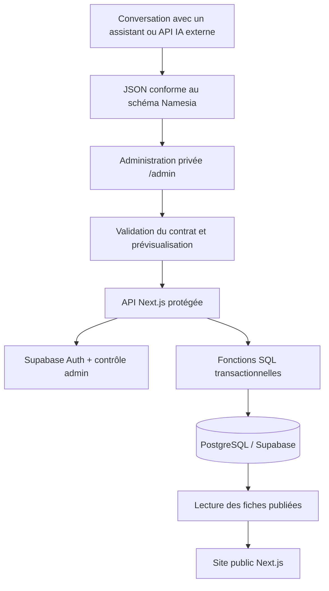

# Architecture — Namesia

- **Statut :** architecture cible retenue pour la V1
- **Version :** 2.1
- **Mis à jour :** 2026-11-22

## 1. Besoin réel

Namesia publie un catalogue de fiches de prénoms. Le contenu est généré en dehors de l'application, soit par une API de modèle, soit dans une conversation avec un assistant. Il est ensuite fourni à Namesia sous la forme d'un JSON conforme au contrat du projet.

Namesia n'intègre pas actuellement de moteur de génération, de collecte documentaire ni de vérification factuelle. L'application importe, conserve, prévisualise et publie le contenu. La génération par IA ne constitue pas une validation de l'exactitude.

## 2. Architecture retenue

Le fournisseur IA est volontairement hors du périmètre applicatif. Il n'existe pas de raison actuelle d'ajouter un adaptateur multi-fournisseurs, un orchestrateur de génération ou une file de traitements.

## 3. Responsabilités

### Production du contenu
- Génération réalisée à l'extérieur de Namesia, par API ou conversation.
- La sortie attendue est un JSON strict conforme à schemas/fiche-prenom.schema.json.
- Le modèle ne choisit jamais le statut de publication.
- Les références, statuts de preuve et métadonnées de vérification ne doivent pas être inventés.

### Administration
- Connexion via Supabase Auth par lien e-mail.
- Autorisation fondée sur la présence de l'identifiant Auth dans private.admin_users.
- Import d'un fichier JSON ou d'un contenu collé.
- Validation du contrat avant envoi.
- Prévisualisation du contenu avant publication.
- Import enregistré comme brouillon ; publication par une action distincte.
- Auto-inscription désactivée ; le premier compte Auth est créé/invité depuis Supabase puis autorisé manuellement.

### API et base de données
- Routes Next.js côté serveur pour les opérations administratives.
- Vérification du jeton Supabase et de l'autorisation par RPC sur chaque requête.
- Fonctions SQL transactionnelles pour créer une version et publier une version.
- Les fonctions sont SECURITY INVOKER ; elles ne contournent pas RLS.
- Aucune clé privilégiée Supabase dans le navigateur.
- Les visiteurs disposent uniquement de la lecture des identités ayant une version publiée et de ces versions publiées.

### Site public
- Rendu serveur Next.js.
- Lecture des fiches publiées uniquement.
- Pas d'appel à un modèle IA lors de l'affichage.
- Initiale calculée à partir du nom affiché ; elle n'est pas stockée.
- Mention visible indiquant que le contenu est généré par IA et peut comporter des erreurs.

## 4. Modèle de données

Le modèle cible comporte trois tables métier :
- names : identité stable du prénom (id, slug, display_name, gender, created_at).
- name_profiles : versions éditoriales (id, name_id, version, schema_version, introduction, origin_text, history_text, usage_text, status, created_at, published_at).
- name_profile_associations : associations symboliques structurées, une ligne par association (profile_id, position, category, value, context_note).

L'autorisation administrateur est stockée dans private.admin_users, un schéma PostgreSQL non exposé par la Data API. Les détails et contraintes sont décrits dans [Modèle de données](modele-donnees.md).

Les tables documentaires historiques (sources, claims, claim_sources) et l'ancienne table de versions ne font plus partie de la cible. Les associations symboliques sont conservées dans une table relationnelle dédiée, car elles sont répétables et filtrables.

## 5. Publication et historique

- Une nouvelle importation crée une nouvelle version en brouillon.
- Une version publiée n'est jamais modifiée en place.
- La publication est explicite et transactionnelle.
- Une seule version est publiée par prénom à un instant donné.
- La version publiée précédente passe à archive.
- Le statut de publication est une donnée Namesia, jamais un champ contrôlé par le JSON entrant.

## 6. Sécurité

- Supabase Auth authentifie l'administrateur.
- private.admin_users autorise explicitement les comptes administrateurs ; les métadonnées utilisateur modifiables ne servent jamais à décider des droits.
- Le schéma private n'est pas exposé à la Data API ; les droits de lecture de la liste sont limités au rôle authenticated et à sa propre ligne.
- Les routes API vérifient le jeton et l'autorisation côté serveur.
- RLS est activé sur toutes les tables exposées.
- Les privilèges SQL sont accordés au strict nécessaire, indépendamment des politiques RLS.
- Les fonctions SQL restent SECURITY INVOKER et vérifient elles-mêmes le rôle administrateur.
- Aucun secret ou clé service_role / secret key dans le code client.
- L'administration n'est pas protégée par le simple masquage d'une page : chaque opération d'écriture vérifie l'autorisation.

## 7. Choix écartés pour la V1

| Option | Décision | Motif |
|---|---|---|
| Génération IA intégrée au site | Écartée | La génération a lieu en amont ; l'import JSON suffit |
| Une table par rubrique de texte | Écartée | Les rubriques ne sont pas exploitées indépendamment |
| Sources et affirmations atomiques | Écartées actuellement | Aucun processus de vérification documentaire n'est assuré |
| Table dédiée aux associations symboliques | Retenue | Données répétables et filtrables, liées à une version |
| Historique de versions | Conservé | Permet de remplacer et restaurer un contenu sans écraser l'historique |
| Microservices / orchestrateur | Écartés | Complexité sans besoin démontré |
| Clé privilégiée dans le navigateur | Interdite | Risque de compromission des données |

## 8. État et migration

Le dépôt et le projet Supabase possèdent un contrat JSON d'import et un écran d'administration. Le JSON est validé puis décomposé atomiquement en colonnes et lignes relationnelles ; il n'est pas stocké comme document global.

La migration de simplification doit :
1. vérifier que chaque rubrique est reprise dans sa colonne et chaque association dans sa ligne relationnelle ;
2. retirer les tables et colonnes devenues inutiles ;
3. corriger les contraintes, privilèges et fonctions de publication ;
4. vérifier les politiques RLS et les accès Data API.

Les migrations déjà appliquées sont synchronisées avec les versions Supabase. La migration destructive finale est préparée dans le dépôt et comporte des contrôles bloquants de reprise des données. Elle ne doit être appliquée qu'après fusion et déploiement de la version applicative qui lit exclusivement le modèle relationnel cible : la production actuelle peut encore dépendre des anciennes tables. Avant son application, effectuer une sauvegarde Supabase et relire le SQL ; l'exécution exige une autorisation explicite. Aucun déploiement Vercel n'est déclenché par cette opération.

## 9. Stack

- Next.js App Router, React et TypeScript.
- Supabase Auth et PostgreSQL.
- JSON Schema comme contrat d'échange ; validation TypeScript à la frontière de l'API.
- GitHub Actions pour les contrôles des PR.
- Vercel uniquement sur main après fusion ; aucun déploiement Preview.
