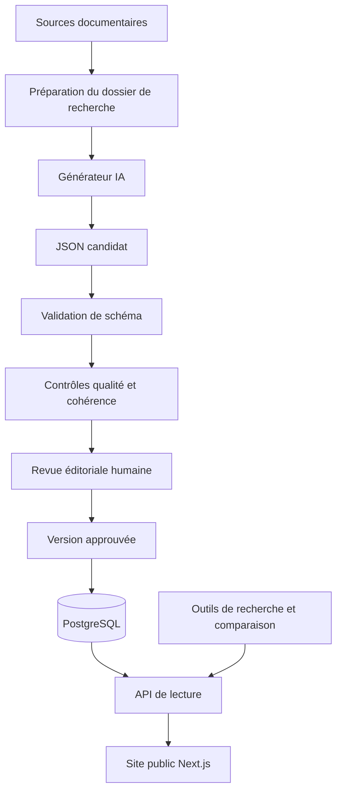

# Architecture cible — Namesia

- **Statut :** proposition initiale à challenger
- **Version :** 1.0
- **Mis à jour :** 2026-11-21

## 1. Objectifs d'architecture

- Séparer le contenu, sa génération, sa validation, son stockage et sa présentation.
- Garder le fournisseur IA remplaçable.
- Faire du JSON validé un contrat d'échange, pas la base de données elle-même.
- Permettre une publication contrôlée et un historique auditable.
- Optimiser le rendu des pages publiques pour le SEO et les performances.
- Préparer plusieurs pays et langues sans complexifier prématurément le MVP.

## 2. Vue logique

La génération ne doit pas écrire directement dans les tables publiées. Elle produit un candidat immuable ; les contrôles et la décision éditoriale déterminent son passage à l'état approuvé.

## 3. Stack envisagée

| Couche | Cible | Motif |
|---|---|---|
| Application web | Next.js + TypeScript | Rendu serveur, routes SEO, composants interactifs |
| Données | PostgreSQL via Supabase | Relationnel, contraintes, migrations, API et outillage |
| Hébergement web | Vercel | Déploiement par branche et previews |
| Validation | JSON Schema + validation TypeScript (ex. Zod) | Contrat interopérable et validation applicative |
| Génération | Adaptateur vers une API de modèle IA | Indépendance vis-à-vis du fournisseur |
| Tests | Tests unitaires, intégration et E2E | Sécuriser le pipeline et les parcours |

Ces choix sont des hypothèses de départ, pas des engagements irréversibles. Les ADR doivent consigner leur validation après vérification des coûts, limites, sécurité et besoins réels.

## 4. Composants et responsabilités

### Catalogue éditorial
- Identité stable du prénom et slug.
- Une ou plusieurs formes linguistiques et variantes.
- Fiches localisées (langue et marché).
- Sources, affirmations factuelles et contenus symboliques séparés.
- Versions de contenu et état de publication.

### Pipeline IA

La procédure détaillée est définie dans [Pipeline de génération IA](pipeline-generation-ia.md), et les exigences de preuve dans [Politique éditoriale et sources](politique-editoriale-et-sources.md).
1. Sélectionner les champs à documenter.
2. Constituer un dossier de sources autorisées.
3. Générer un candidat respectant une version précise du schéma.
4. Valider le JSON et les contraintes métier.
5. Détecter les champs non sourcés, contradictions, doublons et formulations déterministes abusives.
6. Soumettre à une revue humaine.
7. Enregistrer la version approuvée et publier explicitement.

Le modèle ne doit pas fabriquer des références bibliographiques. Une URL ou une référence fournie par le modèle doit être vérifiée par le pipeline avant d'être considérée comme source.

### Site public
- Pages rendues côté serveur.
- Données publiques issues exclusivement de versions publiées.
- Recherche et filtres avec stratégie d'indexation maîtrisée.
- Outils interactifs utilisant les mêmes données canoniques que les fiches.
- Pas d'appel au modèle IA à chaque affichage d'une page.

## 5. Modèle de publication

États recommandés :
- `brouillon` : création ou import initial ;
- `genere` : candidat produit par le pipeline ;
- `a_revoir` : structure valide, contrôle éditorial requis ;
- `approuve` : version validée, pas nécessairement publique ;
- `publie` : version visible sur le site ;
- `archive` : version retirée de la publication.

Les transitions doivent être explicites et historisées. Une modification d'une version publiée crée une nouvelle version candidate ; elle ne modifie pas silencieusement le contenu déjà publié.

## 6. Sécurité et exploitation

- Clés IA et secrets uniquement côté serveur.
- Accès base de données selon le moindre privilège.
- RLS Supabase si accès direct depuis des clients ; privilégier une couche serveur pour les opérations éditoriales.
- Aucun secret dans le dépôt.
- Journaliser les identifiants de génération, modèle, version du prompt, version du schéma et résultat des validations.
- Prévoir sauvegardes, migrations versionnées et procédure de restauration.
- Limiter les coûts IA par quotas, taille des lots et reprises idempotentes.

## 7. Risques et points à challenger

| Risque | Réponse |
|---|---|
| Hallucination d'étymologie ou de source | Corpus de sources, preuves par affirmation, revue humaine |
| Contenu symbolique présenté comme vérité | Taxonomie et avertissement éditorial explicite |
| Pages SEO minces ou dupliquées | Seuil de publication, canonical, noindex des pages utilitaires |
| Statistiques obsolètes | Séries datées séparées du texte éditorial |
| Dépendance fournisseur IA | Adaptateur et prompts versionnés |
| Complexité prématurée | Monolithe modulaire au MVP, pas de microservices |

## 8. Découpage d'implémentation

1. Contrat de contenu et modèle relationnel.
2. Validation JSON et exemples de fixtures.
3. Pipeline candidat / revue / publication.
4. API de lecture et pages de fiches.
5. Recherche et outils interactifs.
6. SEO technique, observabilité et durcissement.

## 9. Décisions à formaliser

Les choix de stack, de stratégie de recherche documentaire, de seuil éditorial, de gestion des statistiques et de workflow de validation devront faire l'objet d'ADR lorsqu'ils seront arbitrés.

## 8. État réel de la première version

L'ADR [ADR-0003](decisions/ADR-0003-premier-site-web.md) transforme les hypothèses web et données en choix provisoires pour la V1.

- **Application :** Next.js App Router, React et TypeScript.
- **Données :** projet Supabase Namesia existant, région `eu-west-1`.
- **Accès public :** lecture depuis les composants serveur avec le SDK Supabase et une clé publishable.
- **Sécurité :** RLS activé sur chaque table exposée ; politiques de lecture limitées aux prénoms et versions publiés ; aucun droit d'écriture accordé au rôle anonyme.
- **Catalogue :** six prénoms initiaux ; le site ne contient pas de catalogue de repli codé en dur.
- **Migrations :** SQL conservé dans `supabase/migrations/`.

Cette implémentation est volontairement plus petite que l'architecture cible : les formes linguistiques, profils par marché/langue, observations statistiques, génération et administration restent à concevoir et à migrer. Ne pas considérer le schéma initial comme la cible complète.

La première connexion Supabase est documentée dans le README et isolée dans `lib/supabase/server.ts` et `lib/prenoms.ts`. Les pages publiques ne doivent jamais utiliser de clé privilégiée.
