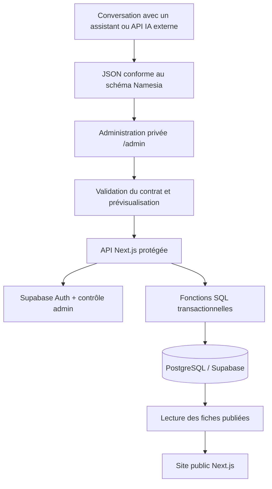

# Architecture — Namesia

- **Statut :** architecture cible retenue pour la V1
- **Version :** 3.5
- **Mis à jour :** 2026-11-22

## 1. Besoin réel

Namesia publie un catalogue de fiches de prénoms. Le contenu est généré en dehors de l'application, soit par une API de modèle, soit dans une conversation avec un assistant. Il est ensuite fourni à Namesia sous la forme d'un JSON conforme au contrat du projet.

Namesia n'intègre pas actuellement de moteur de génération, de collecte documentaire ni de vérification factuelle. L'application importe, conserve, prévisualise et publie le contenu. La génération par IA ne constitue pas une validation de l'exactitude.

## 2. Architecture retenue

Le fournisseur IA est volontairement hors du périmètre applicatif. Il n'existe pas de raison actuelle d'ajouter un adaptateur multi-fournisseurs, un orchestrateur de génération ou une file de traitements.

## 3. Responsabilités

### Production du contenu
- Génération réalisée à l'extérieur de Namesia, par API ou conversation.
- La sortie attendue est un JSON strict conforme à schemas/fiche-prenom.schema.json.
- Le modèle ne choisit jamais le statut de publication.
- Aucun champ de source, référence, preuve ou vérification n'appartient au contrat.

### Administration
- Connexion via Supabase Auth par lien e-mail.
- Autorisation fondée sur la présence de l'identifiant Auth dans private.admin_users.
- Import d'un fichier JSON ou d'un contenu collé.
- Validation du contrat avant envoi.
- Prévisualisation du contenu avant publication.
- Import enregistré comme brouillon ; publication par une action distincte.
- Auto-inscription désactivée ; le premier compte Auth est créé/invité depuis Supabase puis autorisé manuellement.

### API et base de données
- Routes Next.js côté serveur pour les opérations administratives.
- Vérification du jeton Supabase et de l'autorisation par RPC sur chaque requête.
- Fonctions SQL transactionnelles pour créer une version et publier une version.
- Les fonctions sont SECURITY INVOKER ; elles ne contournent pas RLS.
- Aucune clé privilégiée Supabase dans le navigateur.
- Les visiteurs disposent uniquement de la lecture des identités ayant une version publiée et de ces versions publiées.

### Site public
- Rendu serveur Next.js, dynamique pour ne pas dépendre de la disponibilité ou du schéma Supabase pendant le build.
- Frontière d’erreur globale `app/error.tsx` pour les erreurs de rendu des pages : message compréhensible, référence technique éventuelle, tentative de rechargement du segment et retour à l’accueil ; l’erreur est journalisée côté navigateur sans exposer sa trace à l’utilisateur.
- Lecture des fiches publiées uniquement.
- Recherche du catalogue synchronisée avec les paramètres q, genre et lettre de l'URL ; ces valeurs sont validées contre les filtres disponibles, restaurées à l'ouverture du lien et mises à jour sans créer d'entrée d'historique à chaque frappe. L'URL canonique reste /prenoms pour éviter l'indexation de combinaisons de filtres.
- Vitrine de trois prénoms sur l'accueil, issue d'une rotation quotidienne déterministe en UTC du catalogue alphabétique ; la sélection change chaque jour sans modifier l'ordre du catalogue ni les résultats de recherche.
- Découverte aléatoire déclenchée depuis un composant client de l'accueil, à partir de la liste de fiches déjà chargée côté serveur ; le choix reste en mémoire dans le composant et évite la sélection précédente si plusieurs prénoms sont disponibles.
- Favoris gérés par un fournisseur client commun : seuls les slugs sont enregistrés dans localStorage ; aucune fiche, donnée personnelle ou information éditoriale n'est copiée dans le stockage du navigateur. La liste dédiée ne montre que les fiches encore publiées.
- Les favoris ne sont ni envoyés au serveur ni synchronisés entre appareils ; ils restent propres au navigateur utilisé.
- Accès au comparateur depuis une fiche via le paramètre d'URL `prenoms`, qui préselectionne le slug et laisse l'utilisateur choisir les autres prénoms publiés.
- Suggestions contextuelles limitées à trois autres prénoms publiés du même genre, sans présenter cette catégorie comme une similarité étymologique ou culturelle.
- Partage d'une fiche par l'API native du navigateur, avec copie du lien lorsque cette API n'est pas disponible.
- Comparateur client de deux à trois fiches, alimenté par les seules fiches publiées ; les slugs sélectionnés sont synchronisés dans l'URL, sans stockage permanent ; le lien partagé ne conserve que ce paramètre de sélection. La page reste non indexée.
- Images Open Graph générées à la demande depuis les fiches publiées, dans le runtime Node.js pour conserver le client Supabase serveur ; aucune image ni donnée éditoriale supplémentaire n'est stockée.
- Sitemap dynamique construit depuis les fiches publiées ; robots.txt excluant l'administration et les routes API.
- Métadonnées canoniques fondées sur NEXT_PUBLIC_SITE_URL, sans inventer de date de mise à jour.
- Données structurées Schema.org pour le site, le catalogue et les fiches ; aucune date, popularité ou affirmation non disponible n'est ajoutée.
- `lib/site-url.ts` centralise l'origine canonique ; `lib/json-ld.ts` sérialise les données structurées en échappant les chevrons.
- La génération des fichiers d'indexation ne modifie pas les contrôles d'accès ; le domaine Vercel par défaut reste protégé par SSO tant que sa configuration n'est pas changée.
- Pas d'appel à un modèle IA lors de l'affichage.
- Initiale calculée à partir du nom affiché ; elle n'est pas stockée.
- Mention visible indiquant que le contenu est généré par IA et peut comporter des erreurs.
- La recherche du catalogue normalise accents et casse, applique les filtres de genre et d'initiale, puis classe les résultats par pertinence : correspondance exacte, préfixe, puis occurrence ; chaque groupe conserve l'ordre alphabétique français. Si aucun résultat normal n'existe et que le terme compte au moins quatre caractères, le client calcule une distance de Levenshtein bornée et affiche au plus cinq suggestions proches, sans ignorer les filtres actifs.

## 4. Modèle de données

Le modèle cible comporte trois tables métier :
- names : identité stable du prénom (id, slug, display_name, gender, created_at).
- name_profiles : versions éditoriales (id, name_id, version, schema_version, introduction, origin_text, history_text, usage_text, status, created_at, published_at).
- name_profile_associations : associations symboliques structurées, une ligne par association (profile_id, position, category, value, context_note).

L'autorisation administrateur est stockée dans private.admin_users, un schéma PostgreSQL non exposé par la Data API. Les détails et contraintes sont décrits dans [Modèle de données](modele-donnees.md).

Aucune table de sources, références ou preuves n'est nécessaire. Les associations symboliques sont conservées dans une table relationnelle dédiée, car elles sont répétables et filtrables.

## 5. Publication et historique

- Une nouvelle importation crée une nouvelle version en brouillon.
- Une version publiée n'est jamais modifiée en place.
- La publication est explicite et transactionnelle.
- Une seule version est publiée par prénom à un instant donné.
- La version publiée précédente passe à archive.
- Le statut de publication est une donnée Namesia, jamais un champ contrôlé par le JSON entrant.

## 6. Sécurité

- Supabase Auth authentifie l'administrateur.
- private.admin_users autorise explicitement les comptes administrateurs ; les métadonnées utilisateur modifiables ne servent jamais à décider des droits.
- Le schéma private n'est pas exposé à la Data API ; les droits de lecture de la liste sont limités au rôle authenticated et à sa propre ligne.
- Les routes API vérifient le jeton et l'autorisation côté serveur.
- RLS est activé sur toutes les tables exposées.
- Les privilèges SQL sont accordés au strict nécessaire, indépendamment des politiques RLS.
- Les fonctions SQL restent SECURITY INVOKER et vérifient elles-mêmes le rôle administrateur.
- Aucun secret ou clé service_role / secret key dans le code client.
- L'administration n'est pas protégée par le simple masquage d'une page : chaque opération d'écriture vérifie l'autorisation.

## 7. Choix écartés pour la V1

| Option | Décision | Motif |
|---|---|---|
| Génération IA intégrée au site | Écartée | La génération a lieu en amont ; l'import JSON suffit |
| Une table par rubrique de texte | Écartée | Les rubriques ne sont pas exploitées indépendamment |
| Sources et références éditoriales | Écartées | Les fiches sont générées en amont ; Namesia importe le JSON sans workflow documentaire |
| Table dédiée aux associations symboliques | Retenue | Données répétables et filtrables, liées à une version |
| Historique de versions | Conservé | Permet de remplacer et restaurer un contenu sans écraser l'historique |
| Microservices / orchestrateur | Écartés | Complexité sans besoin démontré |
| Clé privilégiée dans le navigateur | Interdite | Risque de compromission des données |

## 8. Schéma en production

Le stockage métier est relationnel et repose sur trois tables :
- `names` porte l'identité stable du prénom ;
- `name_profiles` porte les versions éditoriales et leurs rubriques textuelles ;
- `name_profile_associations` porte les associations symboliques répétables.

Le JSON est uniquement un contrat d'échange à l'import. L'API le valide, puis une fonction SQL crée atomiquement une version brouillon et ses associations. La publication reste une opération distincte et explicite.

Les anciennes tables documentaires, l'ancienne colonne JSONB et les colonnes redondantes ont été supprimées. Le schéma exposé conserve RLS et des privilèges SQL minimaux : lecture publique des seules fiches publiées, opérations d'écriture réservées aux administrateurs autorisés.
## 9. Stack

- Next.js App Router, React et TypeScript.
- Runtime Node.js 26.13.1, défini dans `.nvmrc`, appliqué par GitHub Actions et destiné à être aligné sur le runtime Vercel 26.x ; les types Node 26 suivent cette branche et npm refuse les runtimes incompatibles via `engine-strict`.
- Supabase Auth et PostgreSQL.
- JSON Schema comme contrat d'échange ; validation TypeScript à la frontière de l'API.
- GitHub Actions pour les contrôles des PR.
- Vercel est réservé aux déploiements de production.

## 10. Déploiement et quota

- Le paramètre Vercel `previewDeploymentsDisabled` est activé.
- `vercel.json` appelle `scripts/vercel-ignore-build.sh` avant un build.
- Le script retourne `1` uniquement pour une production issue de `main` ; il retourne `0` dans tous les autres cas, ce qui ignore le build.
- La politique est testée dans GitHub Actions pour les combinaisons production/preview et main/branche.
- Aucune Preview, commande CLI ou création de déploiement par API n'est autorisée.
