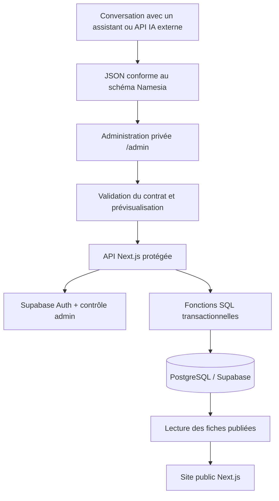

# Architecture — Namesia

- **Statut :** architecture cible retenue pour la V1
- **Version :** 3.76
- **Mis à jour :** 2026-11-24

## Structure de la page

Le layout racine utilise une colonne flex de hauteur minimale égale à la fenêtre. La zone applicative répartit verticalement le contenu principal et le pied de page : le contenu absorbe l'espace libre sur une page courte, tandis que les pages longues conservent leur défilement naturel. La position du pied de page ne dépend ni d'une hauteur arbitraire du contenu ni d'un positionnement fixe.

## 1. Besoin réel

Namesia publie un catalogue de fiches de prénoms. Le contenu est généré en dehors de l'application, soit par une API de modèle, soit dans une conversation avec un assistant. Il est ensuite fourni à Namesia sous la forme d'un JSON conforme au contrat du projet.

Namesia n'intègre pas actuellement de moteur de génération, de collecte documentaire ni de vérification factuelle. L'application importe, conserve, prévisualise et publie le contenu. La génération par IA ne constitue pas une validation de l'exactitude.

## 2. Architecture retenue

Le fournisseur IA est volontairement hors du périmètre applicatif. Il n'existe pas de raison actuelle d'ajouter un adaptateur multi-fournisseurs, un orchestrateur de génération ou une file de traitements.

## 3. Responsabilités

### Production du contenu
- Génération réalisée à l'extérieur de Namesia, par API ou conversation.
- La sortie attendue est un JSON strict conforme à schemas/fiche-prenom.schema.json.
- Le modèle ne choisit jamais le statut de publication.
- Aucun champ de source, référence, preuve ou vérification n'appartient au contrat.

### Administration
- Connexion via Supabase Auth par lien e-mail.
- Autorisation fondée sur la présence de l'identifiant Auth dans private.admin_users.
- Import d'un fichier JSON ou d'un contenu collé.
- Validation du contrat avant envoi.
- Prévisualisation du contenu avant publication.
- Import enregistré comme brouillon ; publication par une action distincte.
- Auto-inscription désactivée ; le premier compte Auth est créé/invité depuis Supabase puis autorisé manuellement.

### API et base de données
- Routes Next.js côté serveur pour les opérations administratives.
- Vérification du jeton Supabase et de l'autorisation par RPC sur chaque requête.
- Fonctions SQL transactionnelles pour créer une version et publier une version.
- Les fonctions sont SECURITY INVOKER ; elles ne contournent pas RLS.
- Aucune clé privilégiée Supabase dans le navigateur.
- Les visiteurs disposent uniquement de la lecture des identités ayant une version publiée et de ces versions publiées.

### Site public
- Rendu serveur Next.js, dynamique pour ne pas dépendre de la disponibilité ou du schéma Supabase pendant le build.
- Shell applicatif Material 3 Fidelity : barre supérieure commune, navigation basse sur fenêtres compactes (largeur ou hauteur) et rail latéral fixe de 80 px sur fenêtres medium/expanded. Les quatre destinations publiques sont partagées entre les deux modes ; les rôles d'interface proviennent du schéma Fidelity ; un schéma Rainbow indépendant fournit des couleurs tonales stables aux catégories éditoriales, avec le rôle on-container correspondant pour leurs badges et leurs libellés. Les deux schémas clair/sombre sont calculés par `lib/material-theme.ts` avec Material Color Utilities depuis la source baseline M3 `#6750A4` ; le même résultat alimente le CSS du `<head>` au rendu serveur et le fournisseur client lors des changements de préférence. Fidelity et Rainbow utilisent explicitement ColorSpec 2021 (version de l'algorithme de couleur, pas version de M3) ; les rôles système absents font échouer le calcul au lieu d’être ignorés.
- Les composants de présentation Material 3 sont centralisés dans `components/material3/` et portent les noms AndroidX officiels : `Button`, `IconButton`, `SearchBar`, `FilterChip`, `InputChip`, `Snackbar`, `TopAppBar`, `NavigationBar` et `NavigationRail`. Ce sont des ports React/HTML explicites des contrats AndroidX Compose Material 3 1.5.0, pas des wrappers de présentation aux noms Namesia. Les compositions métier sont séparées dans `components/features/` (`FavoriteButton`, `FavoritesList`, `FavoritesProvider`, `HistoryProvider`, `RecentNames`, `RecordVisit`, `NameSearch`, `FeaturedNames`, `RelatedNames`, `RandomDiscovery`, `NameComparator`, `ComparisonSelection`, `ShareLink`, `GenreIcon`) et réutilisent ces composants sans redéfinir leurs états. La correspondance exhaustive des quatre genres est centralisée dans `lib/genre-icons.ts` ; `GenreIcon` la rend avec un nom accessible. Les cartes de découverte restent purement navigables ; les actions de favori et de comparaison sont concentrées sur la fiche, tandis que le comparateur garde ses cases à cocher de sélection. Les sélecteurs restent des éléments HTML `select` natifs, stylés par les tokens M3 ; AndroidX Compose ne définit pas de composant `Select` et le navigateur conserve son interaction native. Le registre `components/material3/Icon.tsx` centralise les tracés Google Material Symbols Rounded 400, embarqués localement. L'échelle typographique Material 3 est centralisée dans `styles/material3/tokens.css`, utilise Roboto et applique les tokens `--md-sys-typescale-*` directement sur les éléments HTML sémantiques ; aucune pile de substitution ni couche `Typography` parallèle n'est ajoutée. Les rôles Fidelity/Rainbow sont calculés par `lib/material-theme.ts`, sans alias ni fallback CSS.
- Frontière d’erreur globale `app/error.tsx` pour les erreurs de rendu des pages : message compréhensible, référence technique éventuelle, tentative de rechargement du segment et retour à l’accueil ; l’erreur est journalisée côté navigateur sans exposer sa trace à l’utilisateur.
- Lecture des fiches publiées uniquement.
- La recherche compacte de l'accueil affiche jusqu'à 24 résultats pour rester concise ; lorsque d'autres correspondances existent, un lien ouvre le catalogue avec le terme déjà saisi afin de retrouver l'ensemble des résultats sans ressaisie.
- Recherche du catalogue synchronisée avec les paramètres q, genre et lettre de l'URL ; ces valeurs sont validées contre les filtres disponibles, restaurées à l'ouverture du lien et mises à jour sans créer d'entrée d'historique à chaque frappe. Le paramètre limite conserve aussi le nombre de résultats déjà révélés par lots de 24, à l'ouverture d'un lien et au retour d'une fiche ; toute modification de recherche ou de filtre revient à 24 et retire ce paramètre. L'URL canonique reste /prenoms pour éviter l'indexation de combinaisons de filtres. Une action de partage reconstruit un lien avec une liste blanche des seuls paramètres q, genre, lettre et limite ; aucun paramètre de navigation ou inconnu n'est transmis.
- Les pages d'accueil, de catalogue, de favoris et le sitemap utilisent un index léger (identité, nom, initiale et genre) ; les rubriques éditoriales ne sont chargées que pour les fiches et outils qui les affichent. Cet index est lu par pages demandées de 500 lignes avec `range()` et un ordre stable (`display_name`, puis `id`). Le premier appel demande un compte exact obligatoire et valide ; son absence, son invalidité ou une incohérence avec les lignes reçues interrompt explicitement la lecture. Les offsets suivants avancent du nombre de lignes réellement reçues, même si le plafond de réponse configuré est inférieur à 500. Une page courte ne prouve jamais à elle seule que le catalogue est complet. Les suggestions de fiches réutilisent ce même index paginé au lieu de lancer une seconde lecture non paginée. La recherche et la vitrine d'accueil ne transfèrent donc pas les textes complets au navigateur.
- Vitrine de trois prénoms sur l'accueil, issue d'un échantillon réparti sur le catalogue alphabétique et décalé chaque jour en UTC ; les cartes affichent le nom, son initiale, le pictogramme de genre et l'accès à la fiche. L'échantillon s'adapte aux catalogues de moins de trois fiches et ne modifie jamais l'ordre du catalogue ni les résultats de recherche.
- Découverte aléatoire déclenchée depuis un composant client de l'accueil, à partir de la liste de fiches déjà chargée côté serveur ; le choix reste en mémoire dans le composant et évite la sélection précédente si plusieurs prénoms sont disponibles. Le résultat associe le prénom tiré au sort à son pictogramme de genre accessible et à un lien vers sa fiche, où les actions de favori et de comparaison sont disponibles.
- Historique de session des huit dernières fiches consultées : seuls les slugs sont conservés dans `sessionStorage`, sans cookie, compte, appel réseau ni synchronisation entre appareils. L'historique est propre à l'onglet, survit aux rechargements et disparaît à sa fermeture. Il est dédupliqué et réordonné à chaque visite ; l'accueil n'affiche que les prénoms encore publiés, permet de retirer individuellement une consultation ou d'effacer toute la liste. Les cartes présentent le pictogramme de genre et ouvrent la fiche ; les actions de favori et de comparaison ne sont pas proposées dans l'historique. Si le stockage de session est indisponible, l'historique reste en mémoire jusqu'au rechargement et cette limite est signalée.
- Favoris gérés par un fournisseur client commun : seuls les slugs sont enregistrés dans `localStorage` ; la lecture du stockage et l'import/export partagent une validation stricte des identifiants (format de slug, déduplication et plafond de 10 000 entrées), afin qu'un contenu local modifié ne puisse pas contourner le contrat d'import ; aucune fiche, donnée personnelle ou information éditoriale n'est copiée dans le stockage du navigateur. L'ajout et le retrait d'un favori sont disponibles uniquement depuis la fiche du prénom. La page des favoris charge uniquement l'index léger (nom, slug, initiale et genre), jamais les rubriques éditoriales ; elle propose une recherche locale tolérante aux accents, à la casse et aux séparateurs, un filtre de genre icon-only et un tri par ordre d'enregistrement ou par nom croissant/décroissant. Si la recherche ne renvoie aucun résultat exact, le moteur commun de distance d'édition propose jusqu'à cinq prénoms proches parmi les favoris, après application du filtre de genre. Les critères q, genre, tri et limite sont synchronisés dans l'URL, restaurés au rechargement et transmis aux liens de fiche pour revenir à la liste filtrée avec le même lot visible. Seuls les critères d'affichage sont exposés, jamais les slugs des favoris. La page reste non indexée. La copie en texte reprend tous les résultats filtrés (sans se limiter au lot visible). Son retour est effacé dès que la recherche, le genre ou le tri change ; une réponse asynchrone issue de l’ancienne sélection est ignorée. La liste affiche les résultats par lots de 24 et permet de retirer explicitement de la sélection locale les slugs qui ne correspondent plus à une fiche publiée.
- Les favoris ne sont ni envoyés au serveur ni synchronisés entre appareils ; ils restent propres au navigateur utilisé. La page dédiée permet d'exporter une sauvegarde JSON versionnée contenant uniquement les slugs, puis de la réimporter après validation stricte du format. L'import fusionne les identifiants sans remplacer la sélection existante ; les favoris non publiés restent conservés et peuvent être nettoyés explicitement. Si le plafond de 10 000 favoris est atteint, les identifiants non ajoutés sont comptés et signalés au lieu d'être ignorés silencieusement.
- Accès au comparateur depuis une fiche via le paramètre d'URL `prenoms`, qui préselectionne le slug et laisse l'utilisateur choisir les autres prénoms publiés dans le comparateur. La sélection, limitée à trois prénoms, est gérée par ses cases à cocher natives et ses puces de retrait ; elle est transmise par le même paramètre d'URL, sans stockage durable. Les cartes du catalogue, des favoris, de l'historique et des suggestions ne proposent pas d'action de comparaison.
- Les fiches comparées sont présentées dans un tableau HTML sémantique : chaque critère occupe une ligne et chaque prénom une colonne, ce qui aligne les informations pour une lecture croisée. Sur les écrans étroits, le tableau conserve une largeur minimale et son conteneur permet le défilement horizontal au clavier comme au pointeur ; la colonne des critères reste visible pendant ce défilement.
- Suggestions de découverte limitées à trois autres prénoms publiés du même genre. La fiche ne recharge pas l'index complet du catalogue : elle compte les candidats publiés du même genre, puis lit une fenêtre de 64 identités au maximum, déterminée de façon stable par le slug de la fiche et dans un ordre UUID stable. Les trois suggestions sont choisies dans cet échantillon par un score déterministe calculé à partir du slug de la fiche et de chaque candidat ; elles varient d'une fiche à l'autre et restent stables tant que le catalogue ne change pas. Ce compromis borne le transfert de données et le tri côté serveur, sans prétendre sélectionner les trois meilleurs prénoms du catalogue entier. Le genre est le seul critère éditorial ; aucune similarité étymologique ou culturelle n'est sous-entendue. Seul l'index léger est utilisé (identité, nom, initiale et genre), jamais les contenus éditoriaux des fiches suggérées. Chaque carte est une surface de navigation vers la fiche et n'embarque aucune action de favori ou de comparaison.
- Partage d'une fiche par l'API native du navigateur, avec copie du lien lorsque cette API n'est pas disponible.
- Comparateur client de deux à trois fiches : le sélecteur utilise l'index léger et les rubriques éditoriales sont chargées à la demande uniquement pour les deux ou trois slugs sélectionnés, via une route publique qui valide strictement les paramètres et ne retourne que les fiches publiées. Cette réponse non personnalisée est mise en cache 30 secondes par le navigateur et 1 minute par les caches partagés, avec une fenêtre de revalidation différée d'une minute ; les erreurs ne sont pas mises en cache explicitement. Les slugs sélectionnés sont synchronisés dans l'URL, sans stockage permanent ; le lien partagé ne conserve que ce paramètre de sélection. La page reste non indexée. La recherche normalise accents, casse et séparateurs internes (espaces, tirets, apostrophes) et applique le même classement par pertinence que le catalogue (correspondance exacte, préfixe, puis occurrence la plus proche du début du prénom). Lorsqu'aucune correspondance exacte n'existe et que la recherche comporte au moins quatre caractères, il réutilise le calcul commun de suggestions proches du catalogue (une modification, ou deux à partir de huit caractères), limité à cinq résultats. Un lien vers chaque fiche complète transmet les slugs sélectionnés comme contexte de retour ; le fil d'Ariane et le lien de bas de fiche ramènent au comparateur avec la sélection restaurée. Ce contexte n'est pas ajouté à l'URL canonique et n'est pas stocké durablement. Les prénoms sélectionnés restent visibles dans une liste dédiée, avec retrait individuel même s'ils ne figurent pas dans le lot actuellement affiché ou ne correspondent plus à la recherche en cours. Le sélecteur affiche 24 choix au départ, puis révèle les suivants par lots de 24 ; une nouvelle recherche repart du premier lot.
- Images Open Graph générées à la demande depuis les fiches publiées, dans le runtime Node.js pour conserver le client Supabase serveur ; aucune image ni donnée éditoriale supplémentaire n'est stockée.
- Sitemap dynamique construit depuis les fiches publiées ; chaque URL de fiche expose `lastModified` à partir de `name_profiles.published_at`, date réelle de publication de la version immuable (jamais une date de génération inventée). La lecture est paginée avec compte exact, ordre stable et validation explicite des dates ; robots.txt exclut l’administration et les routes API.
- Métadonnées canoniques fondées sur NEXT_PUBLIC_SITE_URL, sans inventer de date de mise à jour.
- Données structurées Schema.org pour le site, le catalogue et les fiches ; aucune date, popularité ou affirmation non disponible n'est ajoutée.
- `lib/site-url.ts` centralise l'origine canonique ; `lib/json-ld.ts` sérialise les données structurées en échappant les chevrons.
- La génération des fichiers d'indexation ne modifie pas les contrôles d'accès ; le domaine Vercel par défaut reste protégé par SSO tant que sa configuration n'est pas changée.
- Pas d'appel à un modèle IA lors de l'affichage.
- Initiale calculée à partir du nom affiché ; elle n'est pas stockée.
- Mention visible indiquant que le contenu est généré par IA et peut comporter des erreurs.
- La recherche du catalogue normalise accents, casse et séparateurs internes (espaces, tirets, apostrophes), applique les filtres de genre et d'initiale, puis classe les résultats par pertinence : correspondance exacte, préfixe, puis occurrence la plus proche du début du prénom ; les correspondances de même rang et de même position conservent l'ordre alphabétique français. Les liens vers une fiche depuis les résultats et suggestions transportent les critères actifs dans des paramètres de retour dédiés ; le fil d'Ariane, le lien de retour et les suggestions suivantes reconstruisent une URL de catalogue avec q, genre et lettre. Ces paramètres de navigation ne changent ni l'URL canonique de la fiche ni ses métadonnées de partage. Les cartes de résultats et les suggestions affichent le genre de chaque prénom pour donner un repère sans ouvrir la fiche. Si aucun résultat normal n'existe et que le terme compte au moins quatre caractères, le client calcule une distance de Levenshtein bornée une seule fois par prénom candidat, sur les caractères Unicode et dans une bande de largeur proportionnelle à la tolérance (une ou deux modifications), puis affiche au plus cinq suggestions proches triées par distance et ordre alphabétique, sans ignorer les filtres actifs. Le catalogue n'affiche initialement que 24 résultats et permet d'en révéler 24 supplémentaires à la demande ; les filtres et la recherche repartent du premier lot. La liste filtrée peut être copiée en texte brut, avec tous les résultats dans leur ordre de pertinence, au-delà du lot affiché. Son retour est effacé dès que la recherche ou un filtre change ; une réponse asynchrone issue de l’ancienne sélection est ignorée.

## 4. Modèle de données

Le modèle cible comporte trois tables métier :
- names : identité stable du prénom (id, slug, display_name, gender, created_at).
- name_profiles : versions éditoriales (id, name_id, version, schema_version, introduction, origin_text, history_text, usage_text, status, created_at, published_at).
- name_profile_associations : associations symboliques structurées, une ligne par association (profile_id, position, category, value, context_note).

L'autorisation administrateur est stockée dans private.admin_users, un schéma PostgreSQL non exposé par la Data API. Les détails et contraintes sont décrits dans [Modèle de données](modele-donnees.md).

Aucune table de sources, références ou preuves n'est nécessaire. Les associations symboliques sont conservées dans une table relationnelle dédiée, car elles sont répétables et filtrables.

## 5. Publication et historique

- Une nouvelle importation crée une nouvelle version en brouillon.
- Une version publiée n'est jamais modifiée en place.
- La publication est explicite et transactionnelle.
- Une seule version est publiée par prénom à un instant donné.
- La version publiée précédente passe à archive.
- Le statut de publication est une donnée Namesia, jamais un champ contrôlé par le JSON entrant.

## 6. Sécurité

- Supabase Auth authentifie l'administrateur.
- private.admin_users autorise explicitement les comptes administrateurs ; les métadonnées utilisateur modifiables ne servent jamais à décider des droits.
- Le schéma private n'est pas exposé à la Data API ; les droits de lecture de la liste sont limités au rôle authenticated et à sa propre ligne.
- Les routes API vérifient le jeton et l'autorisation côté serveur.
- RLS est activé sur toutes les tables exposées.
- Les privilèges SQL sont accordés au strict nécessaire, indépendamment des politiques RLS.
- Les fonctions SQL restent SECURITY INVOKER et vérifient elles-mêmes le rôle administrateur.
- Aucun secret ou clé service_role / secret key dans le code client.
- L'administration n'est pas protégée par le simple masquage d'une page : chaque opération d'écriture vérifie l'autorisation.

## 7. Choix écartés pour la V1

| Option | Décision | Motif |
|---|---|---|
| Génération IA intégrée au site | Écartée | La génération a lieu en amont ; l'import JSON suffit |
| Une table par rubrique de texte | Écartée | Les rubriques ne sont pas exploitées indépendamment |
| Sources et références éditoriales | Écartées | Les fiches sont générées en amont ; Namesia importe le JSON sans workflow documentaire |
| Table dédiée aux associations symboliques | Retenue | Données répétables et filtrables, liées à une version |
| Historique de versions | Conservé | Permet de remplacer et restaurer un contenu sans écraser l'historique |
| Microservices / orchestrateur | Écartés | Complexité sans besoin démontré |
| Clé privilégiée dans le navigateur | Interdite | Risque de compromission des données |

## 8. Schéma en production

Le stockage métier est relationnel et repose sur trois tables :
- `names` porte l'identité stable du prénom ;
- `name_profiles` porte les versions éditoriales et leurs rubriques textuelles ;
- `name_profile_associations` porte les associations symboliques répétables.

Le JSON est uniquement un contrat d'échange à l'import. L'API le valide, puis une fonction SQL crée atomiquement une version brouillon et ses associations. La publication reste une opération distincte et explicite.

Les anciennes tables documentaires, l'ancienne colonne JSONB et les colonnes redondantes ont été supprimées. Le schéma exposé conserve RLS et des privilèges SQL minimaux : lecture publique des seules fiches publiées, opérations d'écriture réservées aux administrateurs autorisés.
## 9. Stack

- Next.js App Router, React et TypeScript.
- Runtime Node.js 26.13.1, défini dans `.nvmrc`, appliqué par GitHub Actions et destiné à être aligné sur le runtime Vercel 26.x ; les types Node 26 suivent cette branche et npm refuse les runtimes incompatibles via `engine-strict`.
- Supabase Auth et PostgreSQL.
- JSON Schema comme contrat d'échange ; validation TypeScript à la frontière de l'API.
- Les cartes Open Graph chargent localement `assets/fonts/Roboto-Regular.ttf.base64` depuis le runtime Node ; le fichier TTF est distribué sous licence Apache 2.0 avec sa notice dans `licenses/Roboto-Apache-2.0.txt`. Le décodage en mémoire évite un appel réseau au moment de générer les aperçus.
- GitHub Actions pour les contrôles des PR.
- Vercel est réservé aux déploiements de production.

## 10. Déploiement et quota

- Le paramètre Vercel `previewDeploymentsDisabled` est activé.
- `vercel.json` appelle `scripts/vercel-ignore-build.sh` avant un build.
- Le script retourne `1` uniquement pour une production issue de `main` ; il retourne `0` dans tous les autres cas, ce qui ignore le build.
- La politique est testée dans GitHub Actions pour les combinaisons production/preview et main/branche.
- Aucune Preview, commande CLI ou création de déploiement par API n'est autorisée.
